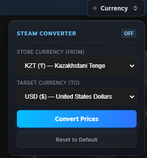
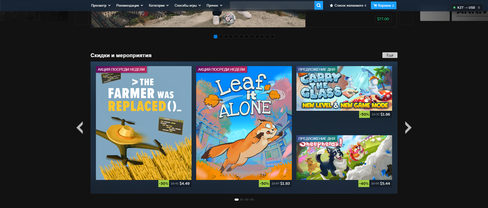

<div align="center">

# 💱 Steam Currency Converter

**A lightweight extension for web browsers and the Steam Desktop Client that dynamically converts prices across the Steam Store, Inventory, and Community Market into your preferred currency at live exchange rates.**


</div>

---

## 🎯 About

If your Steam account is registered in a foreign region (`KZT ₸`, `UAH ₴`, `PHP ₱`, `TRY TL`, `USD $`, `EUR €`, etc.), manually calculating game prices, discounts, and Community Market skin listings quickly becomes tedious.

**Steam Currency Converter** automatically detects your store's native currency and seamlessly replaces all price tags on the page with your target currency (e.g., `RUB ₽`, `USD $`, `EUR €`), preserving Steam's native layout and locale formatting.

---

## 🖼 Screenshots

|       Currency Settings Widget       |      Store & Community Market      |
| :----------------------------------: | :--------------------------------: |
|  |  |

---

## ✨ Key Features

- **Zero-Latency Region Detection (`0 ms`):** Extracts your account's active currency directly from page DOM attributes (`[data-config]`) and SSR scripts, with fallback caching in `sessionStorage`.
- **Full Steam Ecosystem Coverage:**
  - Storefront, game pages, wishlists, and discount blocks (including modern React-based components).
  - User Inventory (starting item prices).
  - Community Market: item listings, buy/sell order tables, and interactive median price graph tooltips on hover.
- **Support for 39 Steam Currencies:** Accurately parses diverse international number formats (`1,000.50`, `1.000,50`, `1 000,50`) as well as multi-character and dual currency symbols (`₸`, `₽`, `$`, `€`, `₱` / `P`, `¥`, `₴`, `R$`, `S/.`, etc.).
- **Reactive DOM Updates:** Tracks dynamically loaded content on scroll and filter changes without frame drops or performance overhead.
- **Native Steam UI Aesthetics:** A compact Glassmorphism floating widget featuring an active currency pair indicator and double-conversion protection.

---

## 🚀 Installation

### Steam Desktop Client (via Extendium / Millennium)

1. Make sure you have a client modding framework with Chrome Extension support installed (e.g., **Extendium** or **Millennium**).
2. Download the latest release archive from **[Releases](../../releases)** (or clone this repository) and extract it to a folder.
3. In the Steam Client, navigate to: **Extendium → Manage Extensions → Advanced extension management → Enable "Developer mode" → Click "Load unpacked"** and select the extracted extension folder.
4. Refresh the active page in your Steam Client.

---

## 🛠 Usage

1. Open any page on the [Steam Store](https://store.steampowered.com/) or [Community Market](https://steamcommunity.com/market/).
2. Click the floating **Currency** button in the top-right corner of the screen.
3. The **Store Currency (From)** field is automatically populated based on your account region.
4. Select your desired currency in the **Target Currency (To)** dropdown and click **Convert Prices**.
5. The exchange rate is cached in `chrome.storage.local` and automatically applied across both the Store and Community pages.
6. To restore original store prices or switch to a different currency, open the widget and click **Reset to Default**.

---

## 🔒 Privacy & Permissions

This extension is completely standalone, open-source, and collects zero user data:

- **`permissions: ["storage"]`** — Used strictly to persist your selected currency pair and exchange rate across `store.steampowered.com` and `steamcommunity.com`.
- **`host_permissions: ["https://open.er-api.com/*"]`** — Used exclusively to fetch live exchange rates via a direct GET request to the free public API [`open.er-api.com`](https://open.er-api.com/) when you click `Convert Prices`.

---

## ⚙️ Under the Hood

Built with pure **Vanilla JavaScript (ES6+)** with zero external dependencies:

- **`TreeWalker API` (`NodeFilter.SHOW_TEXT`):** Traverses only text nodes in the document. Unlike `innerHTML` replacements, this preserves Steam's DOM structure, tooltips, and internal React event listeners.
- **Throttled `MutationObserver` (`30 ms`):** Observes `childList`, `subtree`, and `characterData` mutations, enabling real-time price conversion while scrubbing across Community Market price history graphs without blocking the main thread.
- **Locale Normalization (`Intl` / `toLocaleString`):** Smart rounding (preserving decimals for amounts `< 10` and rounding larger figures to whole numbers) formatted according to the target currency's native locale.

---

## 📁 Project Structure

```text
├── manifest.json   # Extension configuration (Manifest V3)
├── script.js       # Region detection, price parsing, and DOM traversal logic
├── style.css       # Floating widget styles (Steam Glassmorphism UI)
└── README.md       # Project documentation
```
